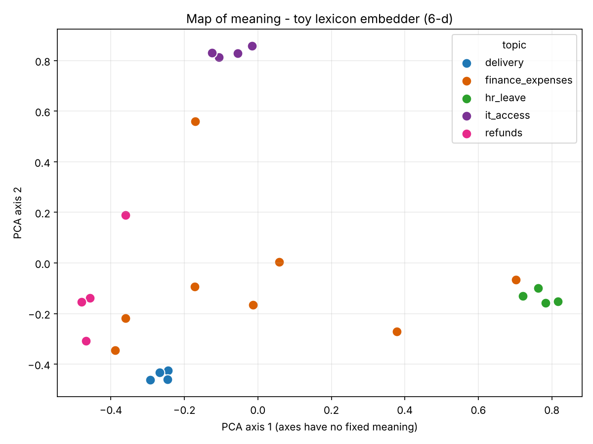

# Day 2 Take-Home - Code and Output (Gowtham)

Model tiers, embeddings and verification. This page shows **the code that was changed** and **the output
of every run**, part by part. The full written answers are in
[`day2_submission/Day2_Take_Home_Submission_Gowtham.pdf`](day2_submission/Day2_Take_Home_Submission_Gowtham.pdf).
Raw console logs are in [`day2_submission/evidence/`](day2_submission/evidence/), and generated reports are in
[`day2_submission/reports/`](day2_submission/reports/).

All data is synthetic. No `.env`, API key or `.venv` is included.

## Status

| Part | Status |
|---|---|
| A - Tier study | Done |
| B - Own query on the 3 Claude tiers | Done |
| B - ChatGPT / Claude.ai / Gemini comparison | **To do**: must be run by hand in the web apps ([steps](day2_submission/PartB_Your_Steps.txt)) |
| C - Embeddings, toy model | Done |
| C - Embeddings, real model | **To do**: blocked on this PC, which needs the Microsoft Visual C++ Redistributable for `onnxruntime` |
| D - Verification pipeline | Done |
| E - Approved-tools guideline | Done (draft) |

## Files changed

| File | What changed | Part |
|---|---|---|
| [`solutions/day2_models_and_embeddings/verify_outputs.py`](../../solutions/day2_models_and_embeddings/verify_outputs.py) | New item `late_interest_percent_per_month`; decimal-matching fix; `clause_coverage()` completeness check | D |
| [`solutions/day2_models_and_embeddings/data/sentences.json`](../../solutions/day2_models_and_embeddings/data/sentences.json) | 8 sentences on the new topic `finance_expenses` | C |
| [`solutions/day2_models_and_embeddings/embeddings_map.py`](../../solutions/day2_models_and_embeddings/embeddings_map.py) | Palette bug fix (the 5th topic was dropped from the map) | C |
| [`solutions/day2_models_and_embeddings/data/my_query_itdesk.txt`](../../solutions/day2_models_and_embeddings/data/my_query_itdesk.txt) | My synthetic source text for Part B | B |
| [`tests/test_day2.py`](../../tests/test_day2.py) | 8 new tests | C, D |

```powershell
python -m unittest discover -s tests
```
```
Ran 80 tests in 0.642s
OK (skipped=1)
```

---

## Part A - Tier study

```powershell
python solutions\day2_models_and_embeddings\compare_tiers_cli.py --query Q1
python solutions\day2_models_and_embeddings\compare_tiers_cli.py --query Q2
python solutions\day2_models_and_embeddings\compare_tiers_cli.py --query Q3
```

Q1 output:
```
tier    ok     secs    cost $   in/out tokens  key numbers       served by
------------------------------------------------------------------------------------------
opus    yes     4.3    0.0314           2/418  2/2 key numbers   claude-haiku-5-5, claude-opus-5-5
sonnet  yes     3.2    0.0118           2/327  2/2 key numbers   claude-sonnet-5-5
haiku   yes     3.8    0.0009           2/822  2/2 key numbers   claude-haiku-5-5
```
Q2 output:
```
opus    yes     2.5    0.0258           2/185  n/a               claude-haiku-5-5, claude-opus-5-5
sonnet  yes     2.0    0.0123           2/161  n/a               claude-sonnet-5-5
haiku   yes     1.3    0.0008           2/149  n/a               claude-haiku-5-5
```
Q3 output:
```
opus    yes     2.9    0.0236           2/193  n/a               claude-haiku-5-5, claude-opus-5-5
sonnet  yes     3.1    0.0114           2/181  n/a               claude-sonnet-5-5
haiku   yes     2.0    0.0006           2/270  n/a               claude-haiku-5-5
```

Correctness judged by me against the reference answers:

| Query | Tier | Correct (0-3) | Seconds | Cost ($) | Length limit | Notes |
|---|---|---|---|---|---|---|
| Q1 | opus | 3 | 4.3 | 0.0314 | Yes (123/150) | 620.00, 24,800.00, No + exact clause 11.4 quote |
| Q1 | sonnet | 3 | 3.2 | 0.0118 | Yes (136/150) | All correct; added an unneeded remark on notice period |
| Q1 | haiku | 3 | 3.8 | 0.0009 | Yes (107/150) | All correct, clear working; 35x cheaper than opus |
| Q2 | opus | 3 | 2.5 | 0.0258 | Yes | Covers all clauses; says no currency is named |
| Q2 | sonnet | 3 | 2.0 | 0.0123 | Yes | Accurate |
| Q2 | haiku | 2 | 1.3 | 0.0008 | Yes | **Invented a currency** not in the source |
| Q3 | opus | 3 | 2.9 | 0.0236 | No (91/80) | Three valid risks + safer alternative |
| Q3 | sonnet | 3 | 3.1 | 0.0114 | No (87/80) | Same quality as opus at under half the cost |
| Q3 | haiku | 3 | 2.0 | 0.0006 | No (131/80) | Good content, worst length control |

**Recommendation:** Sonnet by default for all three task types. Haiku is a candidate for Q1-type extraction
once the Part D verification pipeline re-checks every number. Opus bought nothing extra in these tests.

Reports: [`tier_comparison_Q1.md`](day2_submission/reports/tier_comparison_Q1.md),
[`_Q2.md`](day2_submission/reports/tier_comparison_Q2.md),
[`_Q3.md`](day2_submission/reports/tier_comparison_Q3.md)

---

## Part B - Own query across six tools

### 1. Source text - [`data/my_query_itdesk.txt`](../../solutions/day2_models_and_embeddings/data/my_query_itdesk.txt)

A fictional IT service-desk policy. It includes an email and phone number on purpose, to test redaction.

```powershell
python solutions\day2_models_and_embeddings\redact_pii.py --file solutions\day2_models_and_embeddings\data\my_query_itdesk.txt
```
```
5.1 Escalation. A P2 ticket not resolved within its target is escalated to the Duty Manager ([EMAIL], [PHONE]).

FOUND    : {'EMAIL': 1, 'PHONE': 1}
```

Questions: (1) payroll team blocked: priority and target? (2) a manager asks to reset a colleague's password?
(3) a P3 ticket open for 2 days: escalate under 5.1? (a trap: 5.1 applies only to P2).

### 2. Three Claude tiers

```powershell
python solutions\day2_models_and_embeddings\compare_tiers_cli.py --prompt "<prompt above>"
```
```
tier    ok     secs    cost $   in/out tokens  key numbers       served by
------------------------------------------------------------------------------------------
opus    yes     4.0    0.0258           2/419  n/a               claude-opus-5-5
sonnet  yes     2.7    0.0113           2/261  n/a               claude-sonnet-5-5
haiku   yes     3.7    0.0009           2/740  n/a               claude-haiku-5-5
```
All three tiers scored 3/3 and avoided the trap. Only opus stayed under 120 words.
Report: [`tier_comparison_custom.md`](day2_submission/reports/tier_comparison_custom.md)

### 3-5. ChatGPT / Claude.ai / Gemini - **to do**

Paste the prompt from [`PartB_Your_Steps.txt`](day2_submission/PartB_Your_Steps.txt) into a new chat in each app,
then fill in [`reports/homework_comparison.md`](day2_submission/reports/homework_comparison.md).

---

## Part C - Embeddings experiment

### New topic - `data/sentences.json`

```json
{"topic": "finance_expenses", "text": "Where do I upload hotel receipts from last week's business trip?"},
{"topic": "finance_expenses", "text": "My expense claim for the conference dinner was rejected by finance."},
{"topic": "finance_expenses", "text": "What is the daily meal allowance when travelling for work?"},
{"topic": "finance_expenses", "text": "Can I submit mileage for driving my own car to the client site?"},
{"topic": "finance_expenses", "text": "When is the deadline to file this month's travel expenses?"},
{"topic": "finance_expenses", "text": "Does the company cover the cost of a visa for an overseas assignment?"},
{"topic": "finance_expenses", "text": "My manager has not approved my expense report yet."},
{"topic": "finance_expenses", "text": "Which cost centre code should I use for the training course fee?"}
```

### Bug fix - `embeddings_map.py`

With 5 topics and only 4 colours, `zip()` silently dropped the fifth topic from the map.

```diff
-    palette = ["#1f77b4", "#d95f02", "#2ca02c", "#7b3294"]              # distinct, colour-blind-friendly
+    # distinct, colour-blind-friendly. Take-home: a 5th colour was needed - with only 4, zip() below
+    # silently dropped the fifth topic (finance_expenses) from the map.
+    palette = ["#1f77b4", "#d95f02", "#2ca02c", "#7b3294", "#e7298a", "#666666"]
```

### Toy embedder output

```powershell
python solutions\day2_models_and_embeddings\embeddings_map.py --toy
```
```
Embedder: toy lexicon embedder (6-d)
Embedding 24 sentences ...

QUERY: Reimburse me for the defective goods
  1. sim= 0.90  shared words=1  [refunds] I would like my money returned because the item arrived broken.
  2. sim= 0.88  shared words=2  [refunds] Credit the amount back to my account for the faulty product.
  3. sim= 0.80  shared words=1  [refunds] The invoice was charged twice, so I need a payment reversed.

QUERY: I can't sign into my profile
  1. sim= 1.00  shared words=3  [it_access] I forgot my password and cannot sign in to the portal.
  ...
```

Map: [`evidence/embedding_map_toy.png`](day2_submission/evidence/embedding_map_toy.png)



### A query where the toy embedder fails

```
QUERY: Can I expense a hotel booking?
  query vector: [0.33, 0.63, 0.63, 0.33, 0.03, 0.03]
  sim=0.81 [refunds] I would like my money returned because the item arrived broken.
  sim=0.73 [delivery] The courier left the package at the wrong address.
  sim=0.71 [delivery] My parcel has not arrived and the tracking page shows no update.
```

**Why:** the toy vector has only six word groups (money, delivery, damage, access, leave, security).
"expense", "hotel" and "booking" are in none of them, so the vector is just noise and the matches are wrong.
"My manager has not approved my expense report" lands in `hr_leave` because "manager" is in the leave group:
`[0.11, 0.01, 0.32, 0.11, 0.88, 0.32]`.

### Tests

| Test | Checks |
|---|---|
| `test_new_topic_has_eight_sentences` | The new topic exists with 8 sentences |
| toy synonym limitation | Records why a positive synonym test can't work with the toy embedder |
| `test_real_model_finds_expenses_by_synonym` | Real model finds `finance_expenses` for "Can I expense a hotel booking?" (skipped when the model isn't installed) |

### Real model - **to do**

On this PC `fastembed` is installed, but `onnxruntime` fails with `DLL load failed` because the
Microsoft Visual C++ Redistributable is missing. After installing it from
https://aka.ms/vs/17/release/vc_redist.x64.exe, run:

```powershell
python solutions\day2_models_and_embeddings\embeddings_map.py
```

---

## Part D - Extend the verification pipeline

### Code - `verify_outputs.py`

New item (clause 4.2, 1.5% per month):

```diff
   termination_charge_8m     - money charge if the Customer terminates after 8 months
+  late_interest_percent_per_month - interest rate per month on overdue invoices (percent)
```
```diff
+    late_interest = 1.5                                                  # clause 4.2: 1.5% per month
     return {"monthly_fee": fee, "credit_percent_per_step": step_pct, "credit_cap_percent": cap_pct,
-            "credit_for_98_6": round(credit, 2), "termination_charge_8m": termination}
+            "credit_for_98_6": round(credit, 2), "termination_charge_8m": termination,
+            "late_interest_percent_per_month": late_interest}
```
```diff
-NUMBER_IN_QUOTE = {"monthly_fee", "credit_percent_per_step", "credit_cap_percent"}
+NUMBER_IN_QUOTE = {"monthly_fee", "credit_percent_per_step", "credit_cap_percent", "late_interest_percent_per_month"}
```
```diff
+    "late_interest_percent_per_month": {"value": 1.5, "quote": "Invoices unpaid after 30 days incur interest at 1.5% per month on the overdue amount"},
```

Bug fixed: `1.5` was also matched as `"2"` (from rounding), so a quote saying "2%" would have passed.

```diff
-    forms = {f"{n:,.2f}", f"{n:,.0f}", f"{n:.0f}", f"{n:g}"}
+    forms = {f"{n:,.2f}", f"{n:g}"}
+    if n.is_integer():                       # only whole numbers may be written without decimals;
+        forms |= {f"{n:,.0f}", f"{n:.0f}"}   # otherwise 1.5 would also "match" a quote containing "2"
```

New completeness check (the answer to "what if clause 9.2 was silently left out?"):

```python
REQUIRED_CLAUSES = {"4.1", "4.2", "7.1", "9.2"}

def clause_coverage(findings: dict, document: str) -> set[str]:
    """
    Completeness check: which REQUIRED clauses are not supported by ANY quote in the reply?
    Each clause's text is located in the document; a clause counts as covered when some
    returned quote is found inside that clause's text.
    """
    clauses = {m.group(1): _squash(m.group(2)) for m in
               re.finditer(r"^(\d+\.\d+)\s+(.*?)(?=^\d+\.\d+\s|\Z)", document, flags=re.M | re.S)}
    quotes = [_squash(str(v.get("quote", ""))) for v in findings.values() if isinstance(v, dict)]
    return {c for c in REQUIRED_CLAUSES if not any(q and q in clauses.get(c, "") for q in quotes)}
```
```diff
+    if uncovered:
+        return "MEDIUM", f"Clause(s) {', '.join(sorted(uncovered))} not supported by any quote. A person must check nothing was left out."
```

### Tests

| Test | Checks |
|---|---|
| `test_late_interest_correct_is_low` | Correct 1.5 + real quote -> LOW |
| `test_late_interest_invented_quote_is_high` | Invented "2% per month" quote -> HIGH |
| `test_late_interest_ground_truth` | Ground truth is 1.5 |
| decimal not rounded | 1.5 no longer matches "2" |
| `test_completeness_check_flags_a_silently_missing_clause` | Remove the termination item -> clause 9.2 flagged |

### Output - offline demo (two deliberate errors -> HIGH)

```powershell
python solutions\day2_models_and_embeddings\verify_outputs.py --offline-demo
```
```
item                                  model  expected  quote exists  number in quote  value ok
-------------------------------------------------------------------------------------------
monthly_fee                           12400     12400  yes          yes              yes
credit_percent_per_step                   5         5  yes          yes              yes
credit_cap_percent                       25        20  NO           yes              NO
credit_for_98_6                        1240       620  yes          n/a              NO
termination_charge_8m                 24800     24800  yes          n/a              yes
late_interest_percent_per_month         1.5       1.5  yes          yes              yes

Completeness: required clauses ['4.1', '4.2', '7.1', '9.2']; not covered by any quote: none

RISK TIER: HIGH
-> Possible fabricated evidence. Do not use. A person must review the source.
```

### Output - live (claude-sonnet-5-5 -> LOW)

```powershell
python solutions\day2_models_and_embeddings\verify_outputs.py
```
```
item                                  model  expected  quote exists  number in quote  value ok
-------------------------------------------------------------------------------------------
monthly_fee                         12400.0     12400  yes          yes              yes
credit_percent_per_step                   5         5  yes          yes              yes
credit_cap_percent                       20        20  yes          yes              yes
credit_for_98_6                       620.0       620  yes          n/a              yes
termination_charge_8m               24800.0     24800  yes          n/a              yes
late_interest_percent_per_month         1.5       1.5  yes          yes              yes

Completeness: required clauses ['4.1', '4.2', '7.1', '9.2']; not covered by any quote: none

RISK TIER: LOW
-> All checks passed. Normal practice: spot-check a sample.
```

Audit log ([`reports/verification_audit.jsonl`](day2_submission/reports/verification_audit.jsonl)):
```json
{"time": "2026-10-31T14:36:01+00:00", "source": "offline-demo", "tier": "HIGH", "failed_items": ["credit_cap_percent", "credit_for_98_6"]}
{"time": "2026-10-31T14:36:06+00:00", "source": "claude-sonnet-5-5", "tier": "LOW", "failed_items": []}
```

---

## Part E - Approved-tools guideline (DRAFT)

> DRAFT for discussion. It must be reviewed and confirmed by the organisation's security and legal teams.

| Data class | Example | Claude Code (org key) | Consumer chat (personal) | Enterprise plan chat |
|---|---|---|---|---|
| Public | Published web page | Allowed | Allowed | Allowed |
| Internal | Meeting notes, no personal data | Allowed | **Not allowed** | Allowed, once security confirms the agreement |
| Confidential / personal | Customer names and order history | Ask security | **Not allowed** | Ask security |

Reasons for each cell are in the PDF.
